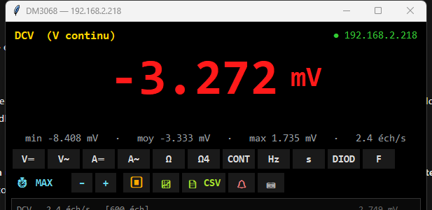

# 📟 DM3068 Overlay

Afficheur de bench **toujours au premier plan** pour le multimètre **Rigol DM3068** :
gros chiffres rouges sur fond noir, bannière `OVERLOAD` cyan, graphique défilant —
le style des incrustations qu'on voit dans les vidéos de réparation sur YouTube,
mais branché sur **votre** multimètre en réseau.


## Fonctionnalités

- **Lecture en direct** (≈ 1–28 échantillons/s selon la fonction) avec préfixes SI
  lisibles : `2.212 µV`, `-3.306 mV`, `198.492 Ω`, `60.006 Hz`…
- **11 fonctions pilotables à distance** : V⎓ V~ A⎓ A~ Ω Ω4f CONT Hz s DIODE F
  (les boutons basculent le multimètre par SCPI, le badge suit aussi les
  changements faits au panneau physique)
- **OVERLOAD** affiché en cyan quand l'entrée sort d'échelle (`9.9E37`)
- **Graphique défilant** (600 points, échelle automatique, les surcharges
  coupent le trait) + **stats min · moyenne · max · taux réel mesuré**
- **Vitesse +/−** : MAX → ÷4 → ÷10 → 1/5 s (cadence d'interrogation)
- **▶/⏸ start-stop** d'acquisition (la série est conservée, graphique gelé)
- **📄 Export CSV** de la série affichée (horodatage, fonction, valeur)
- **🔔 Alarme** : seuil en unité de base, bip sonore + alerte au dépassement
- **📷 Capture PNG** de la fenêtre (nécessite Pillow, optionnel)
- Fenêtre toujours au premier plan, déplaçable ; `Échap` ou croix pour fermer

## Prérequis

- Python 3.8+ — **aucune dépendance obligatoire** (tkinter + socket stdlib)
- Optionnel : `pip install pillow` pour le bouton 📷
- Un Rigol DM3068 sur le réseau (SCPI brut, port TCP **5555**)

## Installation

1. Copier le dossier ; mettre votre IP en tête de `dm3068_overlay.py` :
   ```python
   IP = "192.168.2.218"
   PORT = 5555
   ```
2. Lancer :
   - double-clic sur `dm3068_overlay.bat` (sans console), ou
   - `python dm3068_overlay.py` (ajoutez `--graph` pour démarrer avec le graphique ouvert)

## Utilisation



| Bouton | Effet |
|---|---|
| `V⎓ … F` | change la fonction du multimètre (et donc l'unité affichée) |
| `⏱ − / +` | cadence d'interrogation : MAX → ÷4 → ÷10 → 1/5 s |
| `⏸ / ▶` | stoppe / reprend l'acquisition (graphique gelé) |
| `📈` | ouvre/ferme le graphique défilant |
| `📄 CSV` | exporte la série affichée vers `logs/*.csv` (mode graphique) |
| `🔔` | arme/désarme l'alarme (seuil demandé en unité de base) |
| `📷` | capture PNG de la fenêtre vers `captures/` |

> Le graphique se vide à chaque **changement de fonction** : c'est volontaire,
> les unités et échelles ne sont pas comparables entre elles.

## Notes techniques (protocole)

Sur ce firmware DM3068 (01.01.00) :

- **VXI-11 est muet** (le portmapper TCP/111 accepte la connexion mais ne répond
  jamais) → PyVISA / `python-vxi11` restent bloqués. Inutile d'insister.
- **Le port TCP 5555 parle du SCPI texte brut** (c'était le canal de l'ancien
  applet Java du web control, mort avec les navigateurs modernes) :
  ```python
  import socket
  s = socket.create_connection(("192.168.2.218", 5555))
  s.sendall(b"*IDN?\n")          # -> Rigol Technologies,DM3068,…
  ```
- Les mesures passent par les commandes `:MEAS:<x>?`, qui **basculent la
  fonction et mesurent en un seul appel** ; `:FUNCtion?` renvoie
  `DCV, ACV, DCI, ACI, 2WR, 4WR, CONT, FREQ, PERI, DIODE, CAP`.
- La surcharge est encodée **`9.9E37`**.
- Aucune commande de vitesse (`RATE`, `NPLC`, `ZERO:AUTO`, `APER`… sont
  refusées) : le plafond matériel est fixé par fonction — DCV ≈ 2,7 éch/s,
  CONT ≈ 28 éch/s, DIOD ≈ 25 éch/s, ACV/ACI ≈ 1 éch/s, FREQ/PER ≈ 1 éch/s.
- Un multimètre = **une grandeur à la fois** ; pour suivre V et A simultanément
  comme une alimentation, il faut deux instruments.

## Limites connues

- Résolution graphique ~1–2 Hz sur les fonctions lentes (imposée par le firmware)
- L'alarme est mono-seuil, sens « valeur absolue ≥ seuil »
- Windows uniquement pour le bip (`winsound`) et la capture (Pillow/`ImageGrab`) ;
  le reste est multiplateforme

## Licence

[MIT](LICENSE)
