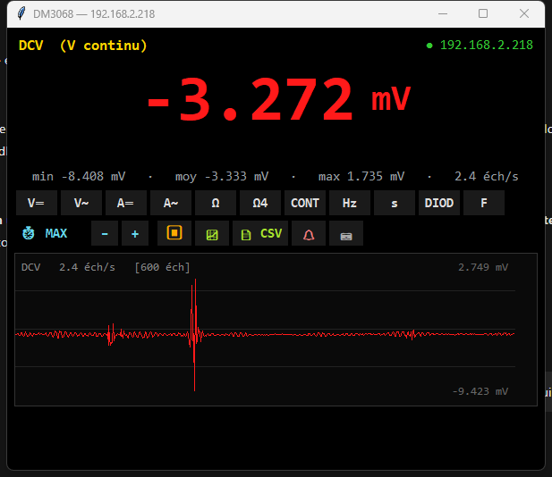

# 📟 DM3068 Overlay

A floating, **always-on-top bench readout** for the **Rigol DM3068** digital
multimeter: big red digits on black, a cyan `OVERLOAD` banner, a scrolling
graph — the kind of inset you see in repair videos on YouTube, but wired to
**your** meter over the network.

*Interface available in **English** (default) and **French** — pick it in the ⚙ settings.*



## Features

- **Live reading** (≈ 1–28 samples/s depending on function) with readable SI
  prefixes: `2.212 µV`, `-3.306 mV`, `198.492 Ω`, `60.006 Hz`…
- **11 remotely switchable functions**: V⎓ V~ A⎓ A~ Ω Ω4f CONT Hz s DIODE F —
  the buttons switch the meter over SCPI, and the badge follows changes made
  on the meter's own panel too
- **OVERLOAD** banner (cyan) when the input is out of range (`9.9E37`)
- **Scrolling graph** (600 points, auto-scaled, overloads cut the trace) with
  **min · avg · max · measured rate** stats
- **Speed − / +**: MAX → ÷4 → ÷10 → 1/5 s (polling cadence)
- **▶/⏸ start-stop** acquisition (series kept, graph frozen)
- **🧹 Clear** wipes the series, stats and graph
- **⚙ Settings**: IP address + language, persisted to `dm3068_overlay.json`
  next to the script
- **▶/■ CSV live logging**: click ▶ to start recording to `logs/*.csv`,
  ■ to stop — rows are written in real time and a `● REC n` counter shows in
  the stats line while recording (works with or without the graph open)
- **🔔 Alarm**: threshold in base unit, beep + banner when exceeded
- **📷 PNG snapshot** of the window (needs Pillow, optional)
- Always on top, movable; `Esc` or the window X closes it

## Requirements

- Python 3.8+ — **no mandatory dependency** (tkinter + stdlib sockets)
- Optional: `pip install pillow` for the 📷 button
- A Rigol DM3068 on the network (raw SCPI, TCP port **5555**)

## Install

1. Clone or copy the folder; your meter's IP is asked once in the ⚙ settings
   (defaults to `192.168.2.218`).
2. Run:
   - double-click `dm3068_overlay.bat` (no console window), or
   - `python dm3068_overlay.py` (add `--graph` to start with the graph open)

## Usage


| Button | Effect |
|---|---|
| `V⎓ … F` | switch the meter function (and the displayed unit) |
| `⏱ − / +` | polling cadence: MAX → ÷4 → ÷10 → 1/5 s |
| `⏸ / ▶` | stop / resume acquisition (graph frozen) |
| `🧹 Clear` | wipe the series, stats and graph |
| `📈` | open/close the scrolling graph |
| `▶ / ■ CSV` | start / stop live logging to `logs/*.csv` (`● REC n` shown in the stats line while recording; the stop message reports the row count and file path) |
| `🔔` | arm/disarm the alarm (threshold asked in base unit) |
| `📷` | save a PNG snapshot to `captures/` |
| `📂` | open the app folder in Explorer (captures/, logs/ live next to the script) |
| `⚙` | settings: IP address, language (English / Français) |

> The graph is wiped on every **function change** on purpose: units and
> scales are not comparable across functions.

## Technical notes (protocol)

On this DM3068 firmware (01.01.00):

- **VXI-11 is dead** (the TCP/111 portmapper accepts the connection but never
  answers) → PyVISA / `python-vxi11` hang forever. Don't bother.
- **TCP port 5555 speaks plain-text SCPI** (it used to feed the old Java
  web-control applet, which modern browsers can no longer run):
  ```python
  import socket
  s = socket.create_connection(("192.168.2.218", 5555))
  s.sendall(b"*IDN?\n")          # -> Rigol Technologies,DM3068,…
  ```
- Measurements go through `:MEAS:<x>?` commands, which **switch the function
  and measure in a single call**; `:FUNCtion?` answers
  `DCV, ACV, DCI, ACI, 2WR, 4WR, CONT, FREQ, PERI, DIODE, CAP`.
- Overload is encoded as **`9.9E37`**.
- No speed commands (`RATE`, `NPLC`, `ZERO:AUTO`, `APER`… are all rejected):
  the hardware ceiling is fixed per function — DCV ≈ 2.7 sps, CONT ≈ 28 sps,
  DIOD ≈ 25 sps, ACV/ACI ≈ 1 sps, FREQ/PER ≈ 1 sps.
- A multimeter measures **one quantity at a time**; to follow V and A at once
  like a bench supply does, you need two instruments.

## Known limits

- ~1–2 Hz on slow functions in graph mode (firmware-imposed)
- The alarm is single-threshold, "absolute value ≥ threshold"
- Windows-only beep (`winsound`) and snapshot (Pillow/`ImageGrab`); the rest
  is cross-platform

## License

[MIT](LICENSE)
